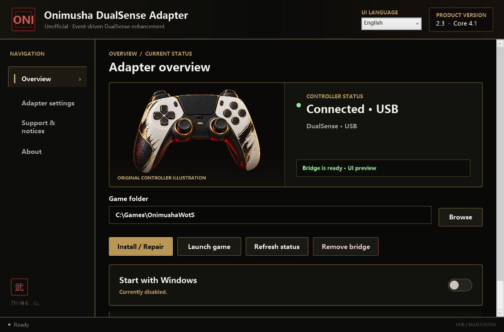
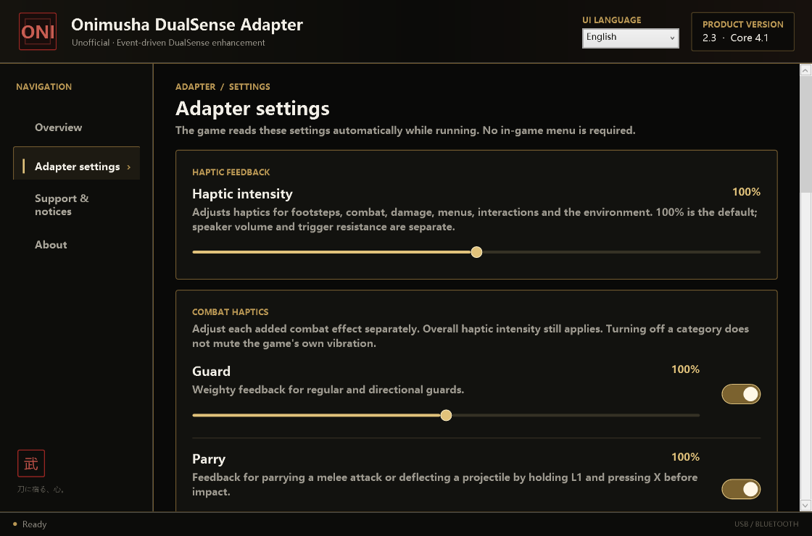
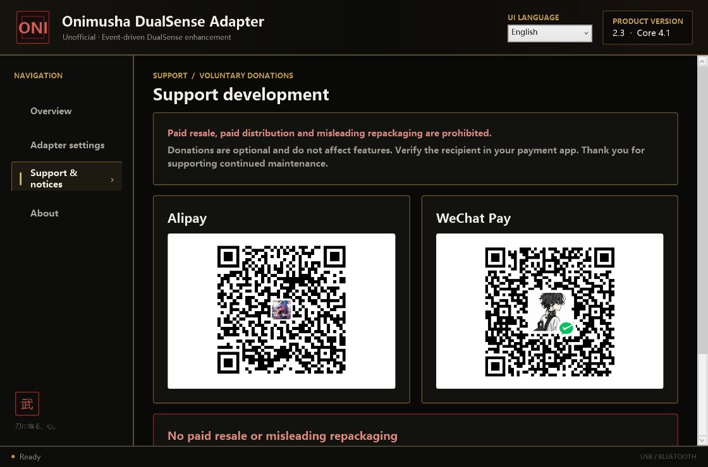

# Onimusha DualSense Adapter (Unofficial)

[中文](README.md) · **English**

DualSense haptics, adaptive triggers and controller-speaker enhancements for the PC game *Onimusha: Way of the Sword* (`OnimushaWotS.exe`). A REFramework plugin reads game events; a native bridge and helper deliver feedback. A bilingual Windows manager handles installation and settings.

**Version 2.3 · Bridge baseline 4.1 · Windows x64.** The official release is free, with no activation key, machine binding or trial countdown. Donations are optional and unlock no features.

> Original code uses a [source-available, no-commercial-resale license](LICENSE.txt), not an OSI-approved open-source license. Third-party code and assets retain their own licenses and rights. This is not an official Capcom or Sony product.

[Releases](https://github.com/zyjmc3231773492-sudo/onimusha-dualsense-adapter-source/releases) · [English guide](docs/USER_GUIDE_2.3_en-US.md) · [中文说明](docs/USER_GUIDE_2.3_zh-CN.md) · [Bilingual release notes](docs/RELEASE_NOTES_2.3.md) · [Validation record, Chinese](docs/RELEASE_QA_2.3.md)

## Features

- **Event-driven haptics:** combat, damage, movement, menus, interactions and environmental feedback. Overall intensity and selected combat categories have separate controls.
- **Adaptive triggers:** effects for actions such as soul absorption and archery, with independent left/right switches.
- **Controller audio:** gauntlet dialogue, several game-effect categories, individual volumes and in-game previews. Chinese/Japanese gauntlet voice selection is independent of the interface language.
- **USB and Bluetooth:** both transports are implemented for DualSense; USB takes priority when both are connected. Audio quality, latency and stability may differ.
- **Bilingual setup and manager:** select Simplified Chinese or English in setup; switch and save the language in the manager.
- **Installation tools:** Steam game discovery, manual selection, Install / Repair, bridge removal, a system tray and optional Windows startup.
- **Optional support:** Alipay and WeChat QR codes appear directly on the support page. The software creates no payment orders and does not read payment status.

## Screenshots

Generated from the 2.3 release staging application using its read-only UI preview mode. Connection status and paths are sample data, not evidence of a hardware connection or a performance test.







Chinese previews are in the [Chinese README](README.md#界面预览).

## Requirements and compatibility

| Item | Requirement or current status |
| --- | --- |
| System | Windows 10 / 11 x64; setup includes the .NET 8 runtime |
| Game | Targets `OnimushaWotS.exe`; Steam App ID `2638890` |
| Recorded baseline | `version.json` records game version `1.0.1.0`, Build ID `24769601`; other builds are not guaranteed compatible |
| DualSense | USB / Bluetooth paths implemented; verify your hardware and game combination |
| DualSense Edge | USB support retained; Bluetooth awaits hardware validation |
| Steam setting | Keep **Enable Steam Input** selected in game Properties → Controller; restart after changing it |
| Other mods | REFramework is bundled; existing loaders or other mods may conflict. Keep backups before making changes |

## Download and install

Choose the appropriate version from [Releases](https://github.com/zyjmc3231773492-sudo/onimusha-dualsense-adapter-source/releases):

| File | Purpose |
| --- | --- |
| `Onimusha-PS5-Adapter-Setup-2.3.exe` | Bilingual Windows installer for users |
| `Onimusha-PS5-Adapter-Source-2.3.zip` | Curated source, build scripts, third-party dependencies and existing payload |
| `SHA256SUMS-2.3.txt` | SHA-256 checksums for both packages |

1. Close the game, run setup, choose Simplified Chinese or English, and read the license and notices.
2. Allow setup to find the game. If it cannot, select the folder containing `OnimushaWotS.exe` in the manager and choose **Install / Repair**. Multiple distinct installations require manual selection.
3. Use a data-capable USB cable, or pair the controller in Windows Bluetooth settings. Check device detection in the manager.
4. Confirm Steam Input is enabled, start the game and adjust haptics, triggers and volume.

Close the game before installing, repairing or removing components. Closing the main window keeps the tray running; exit fully through its menu. REFramework's menu starts hidden; press `Insert` to open it. Bridge removal restores the previous REFramework configuration using the installation record.

```powershell
Get-FileHash .\Onimusha-PS5-Adapter-Setup-2.3.exe -Algorithm SHA256
```

Compare it with the checksum list from the same release. This build is not code signed; Windows may display an unknown publisher. Historical installers reuse the 2.3 filename; use SHA-256 and release notes to identify the exact build.

## Build from source

Use **Windows x64, PowerShell 7, .NET 8 SDK, Visual Studio 2022 Build Tools (MSVC C++, Windows SDK and CMake), and Inno Setup 6**. Initial .NET restore may need network access.

The native scripts use the default Build Tools paths. Adjust `scripts/build-native.cmd` and `scripts/build-opus.ps1` for a different installation location.

```powershell
pwsh -File .\scripts\build-release.ps1
```

The script builds Opus and native components, runs managed and native smoke checks, publishes the self-contained manager, and compiles setup. No release private key or license issuer is required.

- `-SkipInstaller`: generate `release/staging` without setup.
- `-InnoCompiler 'C:\path\to\ISCC.exe'`: select an Inno compiler.
- Default output: `release/Onimusha-PS5-Adapter-Setup-2.3.exe`.

```powershell
pwsh -File .\scripts\package-source.ps1
```

The source packager uses an explicit allowlist and creates a ZIP and file hash manifest. An existing ZIP is retained as a backup; allow extra disk space for building and packaging.

## Repository layout

| Path | Contents |
| --- | --- |
| `src/Manager` | WPF manager, tray, localization, support and notices |
| `src/Product.Core` | Game discovery, installation, settings and device detection |
| `src/Ui.Shared` | Shared interface resources |
| `src/Native` | REFramework bridge, HID/audio helper and event effects |
| `installer` / `scripts` | Inno Setup configuration, build and source packaging |
| `tests` | Managed and C++ smoke checks |
| `third_party` / `legal` | Dependencies and license notices |
| `payload` | Existing REFramework loader, haptics and gauntlet audio |

The distribution excludes historical commercial license issuers, private keys, orders, customer diagnostics, game PAK text dumps and the old international project.

## Validation and limitations

Build, offline regression and bilingual UI checks are recorded in [RELEASE_QA_2.3.md](docs/RELEASE_QA_2.3.md), in Chinese. GitHub preparation verifies source manifests, file hashes and release state; historical checks are not new hardware tests.

- Includes Steam path deduplication and support-page simplification, retaining version 2.3.
- Clean-machine installation coverage, every controller combination and long USB/Bluetooth sessions remain unverified. A successful build does not establish those results.
- Game updates, other mods, Bluetooth adapters and drivers may affect operation. Wind haptics are off by default and may cause continuous light feedback when enabled.
- Provided as is. Report the game build, controller model, transport and reproduction steps; see [Contributing](CONTRIBUTING.md).

## License, assets and donations

You may use, study, modify and redistribute original code free of charge, retaining the license and attribution and identifying modified copies as unofficial. Commercial resale, paid repackaging, mandatory donations and impersonation are prohibited. See [LICENSE.txt](LICENSE.txt) and the [bilingual license files](legal/) for actual terms. These restrictions do not override rights granted by third-party licenses.

REFramework, Opus, the trigger reference and installer translation retain their licenses. See the [third-party notices](legal/BASELINE_THIRD_PARTY_NOTICES.md) and [Bluetooth notices](legal/BLUETOOTH_THIRD_PARTY_NOTICES.txt). Game-derived audio, trademarks and payment-service artwork are not relicensed as project code. Bundling an asset does not prove independent redistribution authorization; verify the relevant rights before public release.

The manager's support page contains the author's Alipay and WeChat QR codes. Donations are voluntary, purchase no license and unlock no features. Confirm the recipient and amount in your payment app.
