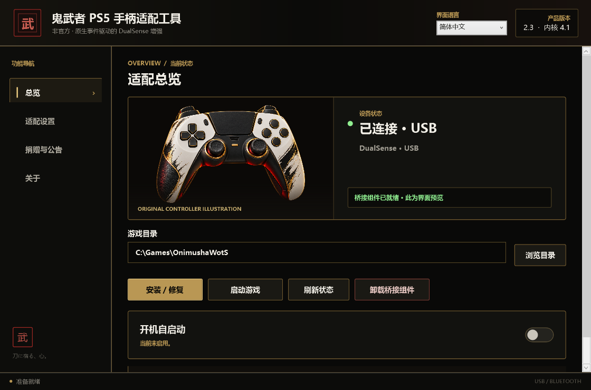
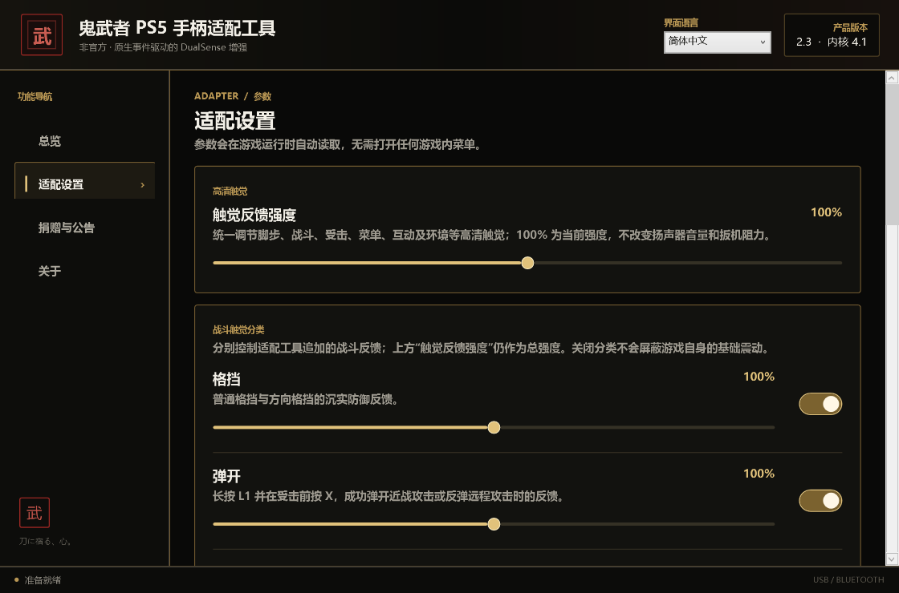
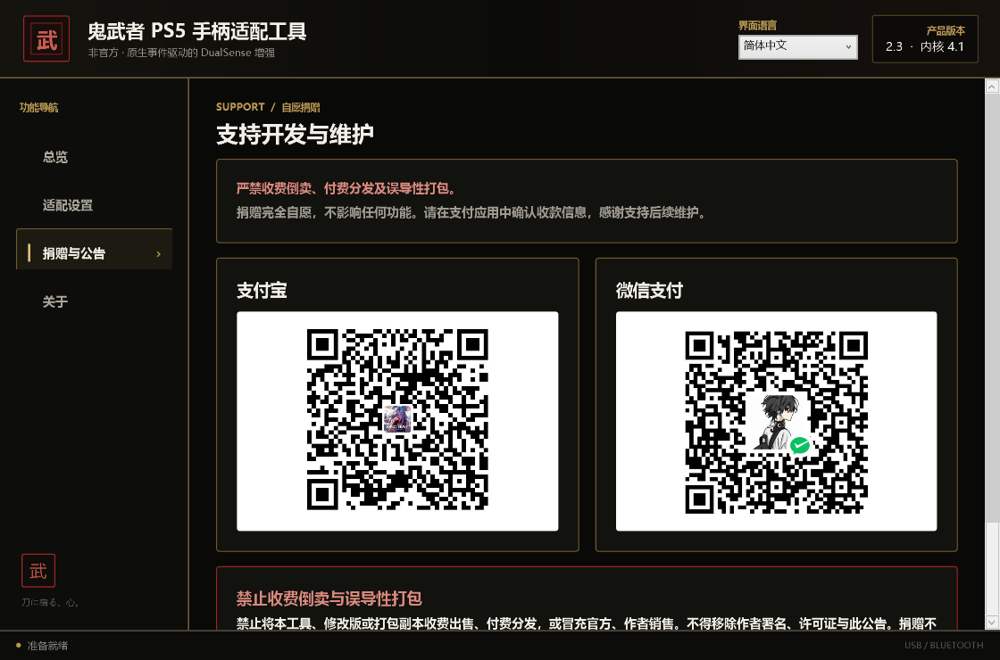

# 鬼武者 PS5 手柄适配工具（非官方）

**中文** · [English](README.en.md)

为 PC 版《鬼武者 剑之道》（`OnimushaWotS.exe`）提供 DualSense 触觉、自适应扳机与手柄扬声器增强。工具通过 REFramework 读取游戏事件，由原生桥接和辅助进程输出反馈，并提供中英文 Windows 图形管理器。

**版本 2.3 · 桥接内核 4.1 · Windows x64。** 官方版本免费，无激活码、设备绑定或试用倒计时。捐赠完全自愿，不解锁功能。

> 本项目原创代码采用[源码公开、禁止商业转售许可](LICENSE.txt)，不属于 OSI 标准开源许可。第三方代码和素材遵循各自许可与权利范围。本工具不是 Capcom 或 Sony 官方产品。

[发行文件](https://github.com/zyjmc3231773492-sudo/onimusha-dualsense-adapter-source/releases) · [中文使用说明](docs/USER_GUIDE_2.3_zh-CN.md) · [English guide](docs/USER_GUIDE_2.3_en-US.md) · [双语发行说明](docs/RELEASE_NOTES_2.3.md) · [验证记录](docs/RELEASE_QA_2.3.md)

## 功能

- **游戏事件触觉**：覆盖战斗、受击、移动、菜单、互动和环境等事件；支持总强度及部分战斗效果的独立开关、强度调节。
- **自适应扳机**：为吸魂、弓箭等动作提供效果，左右扳机可独立开关。
- **手柄扬声器**：笼手语音、多类游戏音效、分类音量和游戏运行时试听。笼手语音可在中文、日文间选择，与管理器界面语言独立。
- **USB 与蓝牙**：DualSense 可使用两种连接，同时连接时优先 USB。两者的音质、延迟和稳定性可能不同。
- **双语管理器与安装器**：安装时选择简体中文或 English，管理器内可再次切换并保存。
- **安装维护**：Steam 游戏目录自动定位、手动选择、安装 / 修复、卸载桥接、系统托盘和可选开机启动。
- **自愿支持**：捐赠页直接显示支付宝与微信二维码；软件不创建订单、不读取付款状态。

## 界面预览

以下图片由 2.3 发布暂存程序的只读预览模式生成。连接状态和游戏路径为演示数据，不代表实机连接或性能测试。







英文预览见 [English README](README.en.md#screenshots)。

## 环境与兼容范围

| 项目 | 要求或当前状态 |
| --- | --- |
| 系统 | Windows 10 / 11 x64；安装包自带 .NET 8 运行时 |
| 游戏 | 针对 `OnimushaWotS.exe`；Steam App ID `2638890` |
| 记录基线 | `version.json` 记录游戏版本 `1.0.1.0`、Build ID `24769601`；不保证其他构建兼容 |
| DualSense | 提供 USB / 蓝牙通路；仍需针对个人硬件与游戏组合验证 |
| DualSense Edge | 保留 USB 支持；蓝牙尚待实机验证 |
| Steam 设置 | 游戏属性 → 控制器 → 保持“启用 Steam 输入”；修改后重启游戏 |
| 其他 Mod | REFramework 随包提供；已有加载器或其他 Mod 可能冲突，修改前保留备份 |

## 下载与安装

从 [Releases](https://github.com/zyjmc3231773492-sudo/onimusha-dualsense-adapter-source/releases) 获取对应版本：

| 文件 | 用途 |
| --- | --- |
| `Onimusha-PS5-Adapter-Setup-2.3.exe` | 普通用户的双语 Windows 安装包 |
| `Onimusha-PS5-Adapter-Source-2.3.zip` | 整理后的源码、构建脚本、第三方依赖和现有 payload |
| `SHA256SUMS-2.3.txt` | 安装包与源码包的 SHA-256 校验值 |

1. 关闭游戏，运行安装包，选择简体中文或 English，阅读许可与公告。
2. 让安装器定位游戏；未找到时，在管理器中选择包含 `OnimushaWotS.exe` 的文件夹，点“安装 / 修复”。多个不同副本需手动选择。
3. 使用可传输数据的 USB 线，或在 Windows 蓝牙设置中配对手柄，确认管理器识别设备。
4. 确认 Steam 输入已启用，启动游戏，再调整触觉、扳机与音量。

安装、修复及卸载前退出游戏。关闭主界面会保留托盘，完全退出请用托盘菜单。REFramework 菜单默认隐藏，按 `Insert` 呼出。卸载桥接时按安装记录恢复先前的 REFramework 配置。

```powershell
Get-FileHash .\Onimusha-PS5-Adapter-Setup-2.3.exe -Algorithm SHA256
```

与同次发行的校验清单比对。本版未进行代码签名，Windows 可能显示未知发布者。历史安装包沿用 2.3 文件名，具体构建应以 SHA-256 和发行说明区分。

## 从源码构建

需要 **Windows x64、PowerShell 7、.NET 8 SDK、Visual Studio 2022 Build Tools（MSVC C++、Windows SDK 和 CMake）及 Inno Setup 6**。首次 .NET 还原可能需要网络。

原生脚本使用 Build Tools 默认路径；安装在其他位置时调整 `scripts/build-native.cmd` 与 `scripts/build-opus.ps1`。

```powershell
pwsh -File .\scripts\build-release.ps1
```

脚本构建 Opus 与原生组件、运行托管和原生 smoke 检查、发布自包含管理器，再编译安装包。无需发行私钥或发码器。

- `-SkipInstaller`：只生成 `release/staging`。
- `-InnoCompiler 'C:\path\to\ISCC.exe'`：指定 Inno 编译器。
- 默认输出：`release/Onimusha-PS5-Adapter-Setup-2.3.exe`。

```powershell
pwsh -File .\scripts\package-source.ps1
```

源码打包使用明确白名单，生成 ZIP 与文件哈希清单。已有同名 ZIP 会保留备份；构建和打包需留出额外磁盘空间。

## 源码结构

| 路径 | 内容 |
| --- | --- |
| `src/Manager` | WPF 管理器、托盘、双语资源、捐赠与公告 |
| `src/Product.Core` | 游戏定位、安装维护、设置与设备检测 |
| `src/Ui.Shared` | 共用界面资源 |
| `src/Native` | REFramework 桥接、手柄 HID / 音频辅助与事件效果 |
| `installer` / `scripts` | Inno Setup 配置、构建与源码打包 |
| `tests` | 托管及 C++ smoke 检查 |
| `third_party` / `legal` | 第三方依赖与许可声明 |
| `payload` | 现有 REFramework 加载器、触觉及笼手音频 |

## 验证与已知限制

构建、离线回归和双语界面检查见 [RELEASE_QA_2.3.md](docs/RELEASE_QA_2.3.md)。本次 GitHub 整理复核源码清单、文件哈希与发布状态，历史检查不作为新的实机测试。

- 包含 Steam 路径去重修复和捐赠页简化，版本仍为 2.3。
- 尚未完成干净机器安装矩阵、所有手柄组合与 USB / 蓝牙长时间回归；构建成功不代表这些项目已通过。
- 游戏更新、其他 Mod、蓝牙适配器和驱动可能影响运行。风感默认关闭，启用后可能产生持续轻微反馈。
- 软件按现状提供。反馈请附游戏构建、手柄型号、连接方式与复现步骤，见[贡献说明](CONTRIBUTING.md)。

## 许可、素材与捐赠

原创代码允许使用、学习、修改及免费分发，须保留许可和署名，修改版应标明非官方。禁止商业转售、收费打包、强制捐赠和冒充作者官方发行。具体范围以 [LICENSE.txt](LICENSE.txt) 及[中英文许可](legal/)为准；本项目限制不覆盖第三方许可已经授予的权利。

REFramework、Opus、扳机参考与安装器翻译等遵循自身许可，见[第三方声明](legal/BASELINE_THIRD_PARTY_NOTICES.md)和[蓝牙组件声明](legal/BLUETOOTH_THIRD_PARTY_NOTICES.txt)。游戏派生音频、商标和支付服务图像不按本项目代码重新授权；文件随包提供不构成独立再分发授权证明，公开发行前仍需核实相应权利。

支付宝 / 微信二维码位于管理器“捐赠与公告”页。捐赠自愿，不购买授权、不解锁功能；付款前请在支付应用核对收款人和金额。
